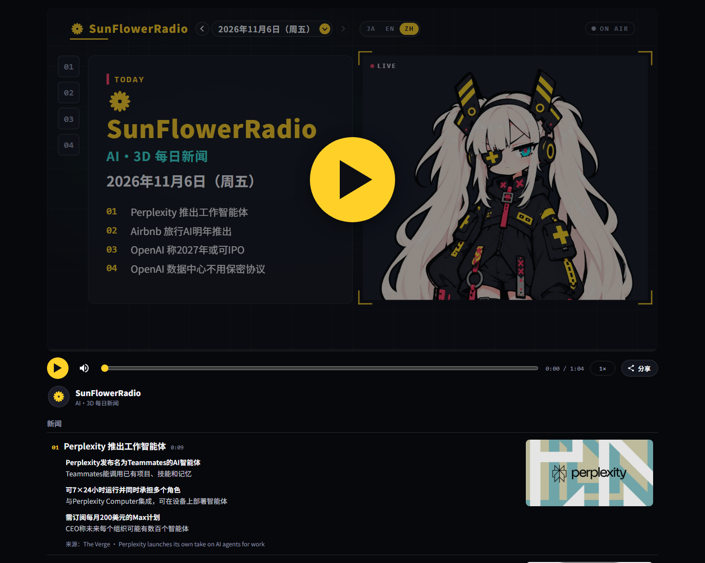

# SunFlowerRadio

> **在线收听：<https://SunGang-pine.github.io/SunFlowerRadio/>**
> **GitHub：<https://github.com/SunGang-pine/SunFlowerRadio>**
> **音色试听：<https://SunGang-pine.github.io/SunFlowerRadio/voices/>**
> **2026-11-06 已生成日本語 / English / 中文三语版本。**
>
> 一个每天早上播报 AI、3D 打印与电子制作新闻的「网页电台」。
> **DeepSeek 写台本 · Microsoft Edge 神经语音配音 · 字幕/幻灯片/口型自动对齐。**



SunFlowerRadio 基于 [myradio](https://github.com/monoradio102/myradio) 的静态电台播放器。播放器本身不需要服务器：`index.html` 读取 `station.json`、`episodes/`、`audio/` 和 `character/`，就是一台完整的电台。

这个仓库在原来的播放器之上，补齐了「每天真正能出片」的制作链路：

- **新闻**：从真实 RSS（TechCrunch、The Verge、Ars Technica、OpenAI、Hackaday、IEEE Spectrum）抓取，保留原文链接与 OGP 卡片。
- **台本**：DeepSeek 根据素材写**日文 / 英文 / 中文**台本，严格输出播放器需要的 JSON；校验失败会自动修正一次。
- **配音**：默认全部用 MiniMax 神经语音（中文温暖女声 / 日文温柔女声 / 英文 Soft-Spoken Girl），逐句合成，自动计算 `lines_timed` 与 `segments`；网络/额度失败时回退到 Edge 或 Windows SAPI。
- **制作台**：本地网页 UI（`/studio/`），填日期、语言、条数就能出片；API Key 只留在本机。
- **校验**：`python -m tools.check` 检查台本、时间轴、音频是否一致。


---

## 快速开始

### 1. 环境

- Windows 10/11
- Python 3.10+（当前机器已验证 3.14）
- `edge-tts`（神经语音，在线；`pip install -r requirements.txt`）
- ffmpeg（用于把 WAV 编码成 MP3、读取时长）
- 可选：Pillow（生成分享卡片时需要，当前环境已安装）

检查：

```powershell
python --version
ffmpeg -version
python -c "import edge_tts; print(edge_tts.__version__)"
```

没有安装依赖时：

```powershell
python -m pip install -r requirements.txt
```

### 2. 启动

双击 **`start.cmd`**，或在仓库根目录运行：

```powershell
powershell -NoProfile -ExecutionPolicy Bypass -File .\start.ps1
```

然后打开：

- 播放器：<http://127.0.0.1:8090/>
- 制作台：<http://127.0.0.1:8090/studio/>

`start.ps1` 会自动打开制作台；`-NoBrowser` 可以只启动服务，`-Port 9000` 可以换端口。

### 3. 连接 DeepSeek

制作台右上角会显示 **DeepSeek 已连接 / 连接 DeepSeek**。点它填入 `sk-...`，保存时会先调用一次 DeepSeek 验证，再写入本机 `.env.local`。

密钥按以下顺序查找：

1. 环境变量 `DEEPSEEK_API_KEY`
2. 仓库根目录的 `.env.local`（制作台保存的位置）
3. 仓库根目录的 `.env`
4. **DSH 的 `~/.dsh/.credentials.yaml`**（如果这台机器已经登录 DSH，会自动复用）

> 密钥不会写进 `station.json` / 台本 / 前端 JS，也不会通过 API 返回给浏览器；API 只返回 `sk-…abcd` 这样的掩码。
> `.env.local` 已加入 `.gitignore`。不要把密钥提交到 GitHub。

可选配置：

```ini
DEEPSEEK_MODEL=deepseek-chat
DEEPSEEK_BASE_URL=https://api.deepseek.com
```

---

## 生成一期节目

### 制作台

1. 选播出日期（默认今天）、语言（日本語 / English / 中文）、新闻条数（3/4/5）。
2. 选素材：
   - **RSS 新闻**：勾选新闻源；每个源最多取 2 条，避免全是同一家。
   - **手动素材**：粘贴文章 URL（每行一个），可再加背景材料。
3. 选择是否生成语音、音色、语速。
4. 点「开始生成」。右侧会实时显示 DeepSeek 写作、配音、时间轴计算的日志。
5. 完成后会出现在「节目库」，点「打开」直接在播放器里看这一期。

### 音色

制作台里的「音色」会随语言切换：

- 中文：晓晓（女 · 温暖）、晓伊（女 · 活泼）、云希（男 · 阳光）、云健（男 · 激情）、云扬（男 · 专业）
- 日语：Nanami（女）、Keita（男）
- English：Ava、Emma、Andrew、Brian

默认使用：

- 中文：**MiniMax 温暖女声**（`Chinese (Mandarin)_Warm_Girl`）
- 日语：**MiniMax 温柔女声**（`Japanese_KindLady`）
- English：**MiniMax Soft-Spoken Girl**（`English_Soft-spokenGirl`）

如果网络或额度不可用，会自动回退到本机 SAPI 音色，并在日志里说明。

**试听全部音色**：

- 线上：<https://SunGang-pine.github.io/SunFlowerRadio/voices/>
- 本地：<http://127.0.0.1:8090/voices/>
- MiniMax 12 音色：<https://SunGang-pine.github.io/SunFlowerRadio/voices/minimax/>（本地 `/voices/minimax/`）
- Edge vs MiniMax A/B：<https://SunGang-pine.github.io/SunFlowerRadio/voices/compare/>（本地 `/voices/compare/`）
- 制作台右上角「试听音色」也可以打开。

试听页里的音频是 11 个 Edge 音色的固定小样；`voices/samples/` 不提交到 Git，`tools/publish.ps1` 发布时会自动生成/带上。

### 可选：MiniMax 音色

MiniMax Speech-2.8 / Speech-02 的中文和日文播报更自然，已经接好了 adapter（默认 `speech-2.8-hd`）：

1. 打开 <https://platform.minimax.io/> → Console → API Keys，创建一个 key；
2. 写入 `.env.local`：

```ini
MINIMAX_API_KEY=你的key
MINIMAX_BASE_URL=https://api.minimax.io
# 如果 key 是在国内平台（platform.minimaxi.com）创建的，改成：
# MINIMAX_BASE_URL=https://api.minimaxi.com
```

> 注意：国内平台的 key 在 `api.minimax.io` 上会返回 `2049 invalid api key`，换成 `api.minimaxi.com` 即可。

3. 重启 `start.cmd`，制作台的「音色」里会出现 MiniMax 音色：
   - 中文：新闻女声、新闻男声、电台主持、温暖女声
   - 日语：温柔女声、沉稳女声、优雅女声、知性男声
   - English：Expressive Narrator、Graceful Lady、Trustworthy Man、Insightful Speaker

MiniMax 是按字符计费的；不配置 key 时，Edge 神经语音仍然是默认，完全不受影响。

生成过程大约 15–60 秒（取决于新闻源与 DeepSeek 响应）。

### 命令行

```powershell
# 只写台本（今天，日语，4 条）
python -m tools.make write --lang ja --count 4

# 只给已有台本配音
python -m tools.make voice --date 2026-11-06 --lang ja --force

# 写台本 + 配音
python -m tools.make episode --date 2026-11-06 --lang ja --count 4 --force-voice

# 给 episodes/ 下所有台本补齐语音
python -m tools.make voice --all

# 只使用某几个 RSS 源
python -m tools.make write --lang ja --feeds techcrunch-ai,hackaday-3d

# 手动素材
python -m tools.make write --lang ja --source-url "https://example.com/a" --source-url "https://example.com/b"
```

中文（`zh`）已经启用：`station.json` 的 `languages` 包含 `ja` / `en` / `zh`，播放器界面、日期、天气和分享卡都有中文。2026-11-06 这一期日/英/中三语都已生成；更早的两期只有日/英，切到中文时会自动回退到该期可用的语言。

### 输出

```
episodes/2026-11-06-ja.json   台本 + lines_timed + segments
audio/2026-11-06-ja.mp3       这一期的声音（不进 git）
episodes.json                 节目列表（日期 / 标题 / 时长）
```

`audio/` 已在 `.gitignore` 中。发布时 `tools/publish.ps1` 只把最近 `keep_days` 天的音频放进 `gh-pages`。

---

## 校验

```powershell
python -m tools.check
```

会逐期检查：

- 台本 JSON 必备字段、新闻数量、`details` 与 `points` 对齐
- `lines_timed` 是否递增、`part` 是否合法
- `segments` 是否首尾相接、最后一段是否等于 `seconds`
- 音频是否存在，MP3 时长与 `seconds` 是否一致

当前 7 期全部通过。

## 目录

```
index.html                 播放器（上游 myradio，未改播放逻辑）
station.json               电台身份 / 语言 / 排期 /  credits
episodes.json              节目列表
episodes/                  台本（日/英）
audio/                     声音（gitignore）
character/                 角色素材
logo.svg                   SunFlowerRadio 向日葵 logo

studio/                    制作台前端（纯静态）
tools/
  server.py                本地服务 + JSON API（只绑定 127.0.0.1）
  config.py                路径、语言、密钥查找
  deepseek.py              DeepSeek 客户端（OpenAI 兼容）
  news.py                  RSS / Atom、文章正文、OGP
  script.py                DeepSeek 台本生成、校验、组装
  voice.py                 Edge 神经语音 / SAPI → WAV → 时间轴 → MP3
  make.py                  命令行入口
  check.py                 自检
  sapi.ps1                 System.Speech 封装
  publish.sh               上游的 gh-pages 发布脚本
  publish.ps1              Windows 版发布脚本（推荐）
  share.py                 上游的分享卡片

.env.example               密钥模板
requirements.txt           Python 依赖（edge-tts / requests / Pillow）
.env.local                 你的本机密钥（gitignore，不会提交）
start.ps1 / start.cmd      一键启动
share/                     每期的分享卡片（tools/share.py 生成）
voices/                    音色试听页（Edge / MiniMax / A-B）
tools/voice_samples.py     生成 Edge 音色试听小样
tools/minimax_samples.py   生成 MiniMax 12 音色试听小样
docs/preview-player.png    播放器截图（日语）
docs/preview-player-zh.png 播放器截图（中文）
docs/preview-studio.png    制作台截图
```

## 工作原理（时间轴）

配音不是先合成一整段再去猜每句的时间。`tools/voice.py` 会：

1. 把 `opening`、每条新闻的 `lines`、`closing` 逐句交给 Edge 神经语音（或 SAPI 备用），生成等长格式的 WAV；
2. 用同一个采样计数拼接：开头 0.6s、句间 0.28s、段落间 1.0s、结尾 2.0s；
3. 由这份 PCM 直接算出每句的 `start` / `end` 与每个 `segments`；
4. 编码成 128 kbps MP3，并回写 `seconds` / `made_at`。

因此字幕、幻灯片、角色口型与声音严格来自同一份时间轴。`python -m tools.check` 会验证 MP3 时长与时间轴一致（误差 < 0.25s）。

## 发布到 GitHub Pages

**已发布：<https://SunGang-pine.github.io/SunFlowerRadio/>**
**仓库：<https://github.com/SunGang-pine/SunFlowerRadio>**

以后更新（Windows，推荐）：

```powershell
powershell -NoProfile -ExecutionPolicy Bypass -File tools\publish.ps1
```

它会：

1. 把 `main` 的静态站文件复制到临时目录；
2. 只带上最近 `station.json.audio.keep_days` 天的音频；
3. 重新生成 `share/` 分享卡片（使用 `station.json.url`）；
4. 重建并强制推送 `gh-pages` 分支。

`tools/publish.ps1 -NoPush` 可以只在本地构建、不推送；`-ShareFont` 指定日文字体，`-ShareFontZh` 指定中文字体。上游的 `tools/publish.sh` 在 Git Bash 下仍然可用。

`tools/share.py` 可以生成每期的分享卡片（需要 Pillow + 日文字体/中文字体）。Windows 上可以这样生成：

```powershell
python tools/share.py --all --font "C:/Windows/Fonts/YuGothM.ttc" --font-zh "C:/Windows/Fonts/NotoSansSC-VF.ttf" --url "https://SunGang-pine.github.io/SunFlowerRadio/"
```

当前 `share/` 里已生成 7 期卡片（含中文）；播放器的「分享」按钮会在卡片存在时出现。`station.json` 的 `url` 已经是正式地址；如果换域名，先改 `url` 再重新生成。

## 设计与素材

- 播放器、`character/`、原版 `station.json` 结构来自 [myradio](https://github.com/monoradio102/myradio)（MIT / CC0，角色可自由使用）。
- 角色为 AI 生成素材；原样保留。
- SunFlowerRadio 的向日葵 logo 为本项目绘制。
- 语音：Microsoft Edge 神经语音（中文晓晓、日文 Nanami、英文 Ava），来自 Edge 在线 TTS；Windows SAPI（Haruka / Zira / Huihui）作为离线备用。DeepSeek 本身只提供文本模型，不提供 TTS 音色。
- 台本由 DeepSeek 根据公开 RSS 素材生成；每条新闻都保留原文链接。新闻事实以原文为准。
- 天气：Open-Meteo（CC BY 4.0），播放器会在页脚显示。

## 注意

- 这是一个**本地制作工具**：服务只监听 `127.0.0.1`，没有登录，别把它暴露到公网。
- DeepSeek 可能会写错片假名或数字；发布前建议在制作台听一遍、对一下原文。`say` 字段专门给 TTS 用，发现读错可以直接改台本。
- 不要提交 `audio/`、`.env.local`、`tools/.cache/`；`.gitignore` 已经处理。
- 生成新闻时请遵守各新闻源的使用条款；本项目只摘写要点并链接原文，不复制全文、不转存图片。
